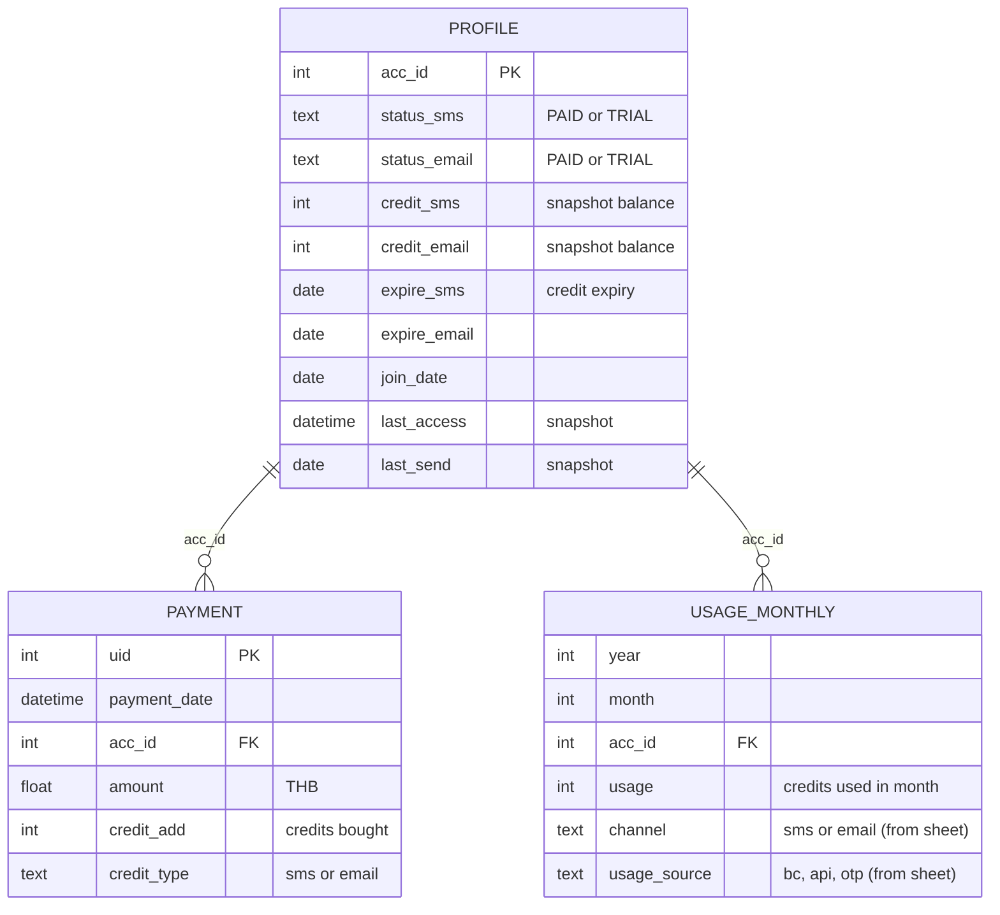

# วิเคราะห์ Dataset 1Moby + ออกแบบ Output ของ 3 โมเดล (Churn / CLV / Credit)

> ไฟล์ที่วิเคราะห์: `data/sample-1moby-workbook.xlsx` (ไฟล์เดิม ไม่ได้ถูกแก้ไขข้อมูล)
> ตัวเลขทุกตัวในรายงานนี้รันจริงจากไฟล์นี้ สคริปต์อยู่ใน `scratch/p1.py` ถึง `p5.py` (รันซ้ำได้)
> **วันที่ข้อมูลจบ:** usage จบ 2025-12, payment จบ 2026-01-05, profile เป็น snapshot ราว 2026-03-02

---

## 0. สรุปสั้น (อ่านตรงนี้ก่อน)

1. **ธุรกิจนี้เป็นแบบ "prepaid, ไม่มีสัญญา" (non-contractual)** ลูกค้าไม่มีปุ่มยกเลิก แค่เงียบหายไป
   ดังนั้น "churn" ไม่มีอยู่ในข้อมูล **ต้องนิยามเอง** จากการที่ลูกค้าไม่ใช้งานและไม่เติมเงินภายในช่วงเวลาหนึ่ง
   วิธีมาตรฐานคือแบบเดียวกับ Kaggle KKBox (ไม่ต่ออายุภายใน X วัน = churn) และแนว Fader–Hardie (BG/NBD)
2. **ชีต `SMS_usage (OTP)` ในไฟล์ตัวอย่างเป็นสำเนาของ `SMS_usage (API)` ทุกแถว** (ตรวจแบบ `equals` = True)
   การแยกชีตไว้แบบตอนนี้ถูกต้อง (เผื่อข้อมูลจริงจะไม่เหมือนกัน) แต่**ถ้ารวมยอดทั้ง 3 ชีต SMS ในไฟล์นี้ ยอด SMS จะเกินจริง ~23%**
   และ feature `otp_usage_share` จะไม่มีความหมาย โค้ดตอนนี้แค่เตือน (warning) แต่ยังนับซ้ำ
3. **ข้อมูลกระจุกมาก:** ลูกค้า 1% บนสุดสร้างรายได้ 50% และสร้าง usage 74%; ลูกค้า 10% บนสุด = รายได้ 84%
   แปลว่าโมเดล CLV/Credit วัดแค่ค่า error เฉลี่ยไม่ได้ ต้องวัดว่า "จับวาฬได้ไหม" ด้วย
4. **ลูกค้าส่วนใหญ่ใช้งานครั้งเดียวหรือแค่เป็นครั้งคราว:** จาก 10,537 บัญชีที่มี usage มี 59% ที่ใช้งานแค่ 1 เดือนจาก 24 เดือน
   และผู้จ่ายเงิน 52% จ่ายแค่ครั้งเดียว ทำให้ churn รายเดือนดูสูง (~21–27%) ถ้านิยามแบบ "เดือนหน้าไม่ใช้ = churn"
5. **Feature ตัวเดียวก็ทำนาย churn ได้ AUC 0.85 แล้ว** (จำนวนเดือนที่ active ใน 6 เดือนก่อน cutoff)
   ถ้าโมเดลไม่ชนะ baseline นี้ชัดเจน แปลว่าโมเดลซับซ้อนไปเปล่าๆ
6. **ข้อผิดพลาดเชิงนิยามในโค้ดตอนนี้** (รายละเอียดในหัวข้อ 8): label ของ credit รวม SMS + Email เข้าด้วยกัน (คนละหน่วย คนละสินค้า),
   `credit_balance_total` เอาเครดิต SMS + Email มาบวกกัน, และ balance proxy นับแค่ตั้งแต่ 2024-01 ทั้งที่ลูกค้าส่วนใหญ่อายุบัญชีเกิน 5 ปี

---

## 1. ภาพรวม Dataset

| ชีต | จำนวนแถว | Grain (1 แถว = ?) | ช่วงเวลา | Key |
|---|---:|---|---|---|
| `Users+User_profile` | 25,093 | 1 บัญชี (snapshot ณ วัน export) | join 2009-02 → 2026-03 | `acc_id` (ไม่ซ้ำ) |
| `Backend_payment` | 13,882 | 1 การเติมเงิน | 2024-01-06 → 2026-01-05 | `uid` (ไม่ซ้ำ) |
| `SMS_usage (BC)` | 25,308 | บัญชี × เดือน | 2024-01 → 2025-12 (24 เดือน) | (year, month, acc_id) |
| `SMS_usage (API)` | 23,726 | บัญชี × เดือน | 2024-01 → 2025-12 | ″ |
| `SMS_usage (OTP)` | 23,726 | บัญชี × เดือน | 2024-01 → 2025-12 | **สำเนาของ API ทุกแถว** |
| `Email_usage (BC)` | 2,370 | บัญชี × เดือน | **2024-10** → 2025-12 (15 เดือน) | ″ |
| `Email_usage (API)` | 869 | บัญชี × เดือน | 2024-01 → 2025-12 | ″ |
| `Email_usage (OTP)` | 256 | บัญชี × เดือน | **2024-09** → 2025-12 (16 เดือน) | ″ |

### กลุ่มบัญชี (จับคู่ข้ามชีต)

| กลุ่ม | จำนวน | หมายเหตุ |
|---|---:|---|
| บัญชีใน profile ทั้งหมด | 25,093 | |
| ไม่มีการจ่ายเงินและไม่มี usage เลยในปี 2024–2025 | **19,247 (77%)** | บัญชีเก่าที่หายไปแล้ว ("Ghost") ไม่ควรเข้าโมเดลใดๆ |
| ผู้จ่ายเงิน (มี payment) | 4,495 | |
| บัญชีที่มี usage | 10,636 | |
| มี usage แต่ไม่จ่ายเงินในช่วงนี้ | 7,017 | ใช้เครดิตเก่าที่ซื้อก่อน 2024 หรือเครดิตฟรี/trial |
| จ่ายเงินแต่ไม่มี usage | 876 | ซื้อเก็บไว้ |
| **มี usage แต่ไม่อยู่ใน profile** | **5,647 บัญชี** | คิดเป็น 4% ของ usage ทั้งหมด ไม่มี join_date/status |
| มี payment แต่ไม่อยู่ใน profile | 114 บัญชี (414 แถว) | 2.4% ของรายได้ |

> [!IMPORTANT]
> Profile **ไม่ได้ครอบคลุมทุกบัญชี** ดังนั้นการหาว่าใครคือลูกค้าที่ต้องคิดด้วย ต้องดูจาก activity (payment + usage) ไม่ใช่ดูจาก profile
> (โค้ดตอนนี้ทำถูกแล้ว แต่ feature ที่มาจาก profile เช่น `customer_age_days` จะเป็น null สำหรับ 5,647 บัญชีนี้)

---

## 2. รายละเอียดแต่ละคอลัมน์: ความหมาย / คุณภาพ / เอาไปใช้ได้ไหม

หลักสำคัญที่สุด: **ห้ามใช้ข้อมูลที่ "เกิดหลัง cutoff" มาสร้าง feature (Point-in-Time, PIT)**
Profile เป็น snapshot ณ วัน export (~2026-03) ดังนั้นตอน train ใช้ไม่ได้ ใช้ได้เฉพาะตอน predict รอบล่าสุดเท่านั้น

### 2.1 `Users+User_profile`

| คอลัมน์ | ความหมาย | คุณภาพ / ข้อสังเกต | ใช้ train ได้? | ใช้ predict ได้? |
|---|---|---|---|---|
| `acc_id` | รหัสบัญชี | ไม่ซ้ำ; **มีช่องว่างท้ายชื่อหัวคอลัมน์** (`"acc_id "`) ต้อง trim | key | key |
| `status (SMS)` | PAID / TRIAL | PAID 24,946, TRIAL 147 | ❌ snapshot | ✅ (เป็น context) |
| `status (Email)` | PAID / TRIAL | TRIAL 24,741, PAID 352 แปลว่าเกือบทุกบัญชีเป็น TRIAL ฝั่ง email | ❌ | ✅ |
| `user.credit + user.credit_premium` | เครดิต SMS คงเหลือ | 0 = 19,635; >0 = 5,456; ติดลบ 2 บัญชี; max 23.4M | ❌ snapshot | ✅ **สำคัญมากสำหรับ credit runway** |
| `credit_email` | เครดิต email คงเหลือ | ค่า 2000 = 19,172 บัญชี น่าจะเป็นเครดิตฟรีที่ให้ตอนเปิดบัญชี | ❌ | ✅ (ต้องตัดค่าเริ่มต้น 2000 ออก) |
| `expire` | วันหมดอายุเครดิต SMS | null 4,025; ค่า **2100-09-05** ใช้แทน "ไม่หมดอายุ"; median 2021 คือส่วนใหญ่หมดอายุไปแล้ว | ❌ | ✅ (บังคับให้ต้องเติมเงินก่อนเครดิตหมดอายุ) |
| `expire_email` | วันหมดอายุเครดิต email | 19,202 บัญชีมีค่า 2026-03-05 เหมือนกัน แปลว่าเป็นค่า default ของ trial | ❌ | ⚠️ |
| `join_date` | วันสมัคร | null 1; ตั้งแต่ 2009 | ✅ (ค่าคงที่) | ✅ |
| `last_access` | login ล่าสุด | null 9,851 | ❌ snapshot | ✅ (สัญญาณ engagement ที่ดี) |
| `last_send` | ส่งล่าสุด | null 18,777; ต่ำสุด 2023-07 แปลว่าระบบเก็บย้อนหลังได้จำกัด | ❌ snapshot | ✅ |

### 2.2 `Backend_payment`

| คอลัมน์ | ความหมาย | คุณภาพ / ข้อสังเกต |
|---|---|---|
| `uid` | รหัสธุรกรรม | ไม่ซ้ำ |
| `payment_date` | วันเวลาที่เติมเงิน | ข้อมูลเดือน 2026-01 มีแค่ 5 วัน (74 แถว) **ห้ามนับเป็นเดือนเต็ม** |
| `acc_id` | บัญชี | 114 บัญชีไม่อยู่ใน profile |
| `amount` | ยอดเงินบาท | **23 แถวเป็น 0** (น่าจะเป็นเครดิตแถม); **2.7% เป็นทศนิยม** เช่น `672,897.196…` = 720,000 / 1.07 แปลว่าบางแถวเป็น**ยอดก่อน VAT** แต่บางแถวรวม VAT แล้ว ต้องถามทีมการเงิน |
| `credit_add` | จำนวนเครดิตที่ได้ | |
| `credit_type` | `sms` (13,467) / `email` (415) | email มีแค่ 3% ของธุรกรรม |

**โครงสร้างราคา SMS (บาท/เครดิต) เป็นแบบขั้นบันได** ยิ่งซื้อมากยิ่งถูก:

| ขนาดแพ็กเกจ (บาท) | ≤2k | 2k–5k | 5k–11k | 11k–31k | 31k–100k | >100k |
|---|---|---|---|---|---|---|
| ราคา/เครดิต (median) | 0.56 | 0.58 | 0.48 | 0.40 | 0.35 | 0.17 |

แพ็กเกจยอดนิยม: 10,500 (4,772 ครั้ง), 4,500 (3,197), 30,000 (1,784), 90,000 (1,679) บาท

**พฤติกรรมการเติมเงิน:**
- จำนวนครั้งต่อผู้จ่าย: median 1, mean 3.1, max 139 → มี **2,163 คน (48%) ที่จ่าย ≥ 2 ครั้ง** (จำนวนนี้คือคนที่ BG/NBD + Gamma-Gamma ใช้ได้)
- ระยะห่างระหว่างการเติม: median 23 วัน, p75 73 วัน, p90 215 วัน, p95 360 วัน
- เติมหลายครั้งในวันเดียวกัน: 518 กรณี (ต้องรวมเป็น 1 ครั้ง/วัน ก่อนเข้า BG/NBD)
- รายได้รายเดือน: 24–45 ล้านบาท, ผู้จ่าย/เดือน ~350–510 ราย

### 2.3 Usage (6 ชีต)

| คอลัมน์ | ความหมาย | ข้อสังเกต |
|---|---|---|
| `year`, `month` | เดือน | ข้อมูลเป็น**รายเดือน** แปลว่า cutoff ต้องอยู่ต้นเดือนเสมอ (ไม่งั้น feature จะเห็นข้อมูลหลัง cutoff) |
| `acc_id` | บัญชี | 5,647 บัญชีไม่อยู่ใน profile |
| `usage` | จำนวนที่ใช้ในเดือนนั้น | มีแถวที่เป็น 0 (SMS BC 316, Email BC 595) แปลว่ามีแถวแต่ไม่ได้ใช้ **ต้องถามว่าหน่วยเป็น "ข้อความ" หรือ "เครดิต"** (SMS ภาษาไทย/ยาว 1 ข้อความอาจกินหลายเครดิต) |

**สัดส่วน usage (ไม่นับ OTP ของ SMS ที่ซ้ำ):** SMS = BC 77% / API 23%; Email = BC 78% / API 20% / OTP 2%
**ลูกค้าแยกตามช่องทาง:** SMS อย่างเดียว 9,698 · Email อย่างเดียว 530 · ใช้ทั้งสองอย่าง 309

> [!WARNING]
> **SMS usage กับ Email usage ใช้หน่วยคนละแบบ และราคาต่างกัน** (SMS ~0.17–0.58 บาท/เครดิต, Email ~0.04–0.30 บาท/เครดิต)
> ปริมาณ email ช่วงพีคเคยสูงถึง 6.3 ล้าน/เดือน แต่ email ทำรายได้แค่ 3% เพราะงั้น **ห้ามเอามาบวกกันเป็น "credit usage" ก้อนเดียว**
> Email BC เริ่มมีข้อมูลตั้งแต่ 2024-10 เท่านั้น ช่วงก่อนหน้าไม่ใช่ศูนย์จริง แต่เป็นช่วงที่ไม่มีข้อมูล

---

## 3. ลักษณะธุรกิจที่ข้อมูลบอก

| ลักษณะ | หลักฐานจากข้อมูล | ผลต่อการออกแบบ |
|---|---|---|
| Prepaid, ไม่มีสัญญา | ไม่มีวันยกเลิก มีแค่การเติมเงินกับการใช้งาน | churn ต้องนิยามด้วย "ช่วงที่ไม่มี activity" |
| มีคนใช้เป็นครั้งคราวเยอะ | 59% ใช้แค่ 1 เดือน; 893 บัญชีหายไปเกิน 3 เดือนแล้วกลับมาใช้ใหม่ | ถ้าวัด churn ด้วยช่วงสั้น (1 เดือน) จะได้ false churn เยอะ |
| กระจุกตัวสูงมาก (Pareto) | top 1% = 50% รายได้, 74% usage | ต้องใช้ metric แบบถ่วงน้ำหนักด้วยมูลค่า และดูกลุ่มวาฬแยก |
| ซื้อแบบเป็นก้อน (lumpy) | median ห่าง 23 วัน แต่ p90 = 215 วัน | รายได้รายเดือนแกว่งมาก ดู NRR ระดับไตรมาส/บัญชีจะเสถียรกว่า |
| ข้อมูลถูกตัดด้านซ้าย (left-censoring) | payment/usage เริ่ม 2024-01 แต่บัญชีเก่าสุดปี 2009 | ยอด "เครดิตซื้อ − เครดิตใช้" ที่คำนวณจากปี 2024 เป็นต้นไป**ไม่ใช่ยอดคงเหลือจริง**; คนที่ "ไม่เคยจ่าย" อาจแค่จ่ายไว้ก่อนปี 2024 |
| จำนวนผู้ใช้ค่อนข้างคงที่ | MAC (บัญชีที่ใช้งานรายเดือน) 1,766–2,279, ค่อยๆ โตขึ้น | — |

---

## 4. KPI ระดับธุรกิจ: นิยามและค่าจริงจากข้อมูล

ส่วนนี้ตอบคำถามว่า **"churn rate คือ % ของอะไร ใน 1 เดือน"**
ตัวเลขข้างล่างเป็นตัวเลข**เชิงพรรณนา (descriptive)** ที่คำนวณได้ตรงๆ ไม่ต้องใช้โมเดล และควรแสดงบน dashboard ระดับภาพรวม

### 4.1 นิยาม "Active" (ใช้ร่วมกันทุก KPI)

> บัญชีจะ **active ในเดือน M** ถ้าในเดือน M มี usage > 0 ในช่องทางใดก็ได้ **หรือ** มีการเติมเงิน

### 4.2 Churn rate ระดับลูกค้า (Logo churn): แนะนำใช้ **กฎ 90 วัน**

$$
\text{Churn rate}_M = \frac{\#\{\text{บัญชีที่ active ในเดือน } M \text{ และไม่ active เลยในเดือน } M{+}1..M{+}3\}}{\#\{\text{บัญชีที่ active ในเดือน } M\}}
$$

- **ตัวหาร** = ทุกบัญชีที่ active ในเดือน M (ไม่ใช่ลูกค้าทั้งหมดใน profile)
- **ตัวตั้ง** = ในกลุ่มนั้น คนที่เงียบหายไปทั้ง 3 เดือนถัดไป
- รายงานค่าของเดือน M ได้ก็ต่อเมื่อผ่านไปแล้ว 3 เดือน (เดือนล่าสุดที่คำนวณได้คือ 2025-09)

| เดือน | Active | Churn (1 เดือน: เดือนหน้าไม่ใช้) | **Churn (90 วัน)** |
|---|---:|---:|---:|
| 2024-01 | 1,776 | 26.5% | 21.4% |
| 2024-06 | 1,824 | 24.9% | 20.3% |
| 2024-12 | 1,858 | 23.9% | 18.0% |
| 2025-03 | 2,002 | 25.8% | 19.5% |
| 2025-06 | 2,106 | 23.7% | 19.2% |
| 2025-09 | 2,111 | 21.1% | **16.1%** |

**ทำไมไม่ใช้แบบ 1 เดือน:** มันนับคนที่แค่หยุดพักเดือนเดียวเป็น churn ด้วย (ต่างกัน ~5 จุดเปอร์เซ็นต์)
และทำให้ dashboard แจ้งเตือนผิด ส่วน 90 วันเป็นค่ากลางที่ใช้ทั่วไปกับ B2B ที่ไม่มีสัญญา

### 4.3 KPI อื่นที่ควรมี (คำนวณได้จาก data ตรงๆ)

| KPI | สูตร | ค่าจากข้อมูลนี้ |
|---|---|---|
| **MAC** (Monthly Active Customers) | จำนวนบัญชีที่ active ในเดือน M | 1,766 → 2,279 |
| **Paying churn (180 วัน)** | ในกลุ่มคนที่เคยจ่ายและ active ใน 180 วันก่อน cutoff สัดส่วนคนที่ไม่มี activity เลยใน 180 วันถัดไป | ~31% (cutoff 2025-01/04/07) |
| **Payer churn รายปี** | ผู้จ่ายช่วง 2024H2 ที่ไม่จ่ายเลยในปี 2025 | 46.7% |
| **GRR** (Gross Revenue Retention) รายไตรมาส | $\sum_i \min(\text{use}_{i,Q+1}, \text{use}_{i,Q}) \,/\, \sum_i \text{use}_{i,Q}$ คิดเฉพาะบัญชีที่ active ใน Q | 48%–77% |
| **NRR** (Net Revenue Retention) รายไตรมาส | $\sum_i \text{use}_{i,Q+1} \,/\, \sum_i \text{use}_{i,Q}$ คิดเฉพาะบัญชีที่ active ใน Q | 60%–122% |
| **Revenue / ผู้จ่าย / เดือน** (ARPPU) | รายได้เดือน M ÷ จำนวนผู้จ่ายในเดือน M | ~60k–90k บาท (ค่าเฉลี่ยถูกวาฬดึงขึ้น ควรแสดง median ด้วย) |
| **New active** | บัญชีที่ active ครั้งแรกในช่วงข้อมูล | ~265–640/เดือน (ช่วงต้นปี 2024 สูงเกินจริงเพราะ left-censoring) |
| **Reactivation** | กลับมา active หลังหายไป ≥ 3 เดือน | 893 บัญชีใน 24 เดือน |
| **Revenue concentration** | สัดส่วนรายได้ของ top 1% / 10% | 50% / 84% |

> [!NOTE]
> GRR/NRR ในตารางใช้ **usage เป็นตัวแทนรายได้** เพราะการเติมเงินเป็นก้อนๆ ยอดรายเดือน/รายไตรมาสเลยแกว่งมาก ส่วน usage สะท้อนรายได้ที่เกิดขึ้นจริง (revenue recognition) ได้ดีกว่า

---

## 5. หลักสากล: แต่ละโมเดลปกติใช้ข้อมูลอะไร ได้ output อะไร

### 5.1 Dataset อ้างอิง (Kaggle / งานวิชาการ) ที่ใกล้เคียงกับเรา

| งานของเรา | Dataset อ้างอิง | เหมือนเราตรงไหน | ต่างจากเราตรงไหน |
|---|---|---|---|
| Churn | **KKBox WSDM Churn (Kaggle 2017)** | label = "ไม่ทำธุรกรรมใหม่ภายใน 30 วันหลังหมดอายุ" มีทั้ง transaction log และ user log รายวัน | เป็น subscription รายเดือน ส่วนเราเป็น prepaid |
| Churn | IBM Telco Churn | — | มีสัญญาและคอลัมน์ `Churn` มาให้เลย **ไม่เหมาะกับเรา** อย่าเอามาเป็นแบบ |
| CLV | **CDNOW** (ข้อมูลคลาสสิกของ Fader–Hardie), **UCI Online Retail II** | transaction log แบบไม่มีสัญญา, RFM, BG/NBD + Gamma-Gamma | เป็น B2C ส่วนเราเป็น B2B ที่มีวาฬ |
| Credit usage | **M5 Forecasting (Kaggle, Walmart)** | time series จำนวนมาก, หลายตัวเป็นศูนย์สลับกับยอดพุ่ง (intermittent), track uncertainty ใช้ quantile + pinball loss | เป็นรายวันระดับสินค้า ส่วนเราเป็นรายเดือนระดับบัญชี |
| Top-up timing | Survival analysis (เช่นงานทำนายการเติมเงินของ prepaid telco) | time-to-event มีข้อมูลที่ยังไม่เกิด event (censored) | — |

### 5.2 Churn (ลูกค้าจะเลิกใช้ไหม)

**คำถามธุรกิจ:** "ลูกค้าคนไหนที่ยังใช้อยู่ตอนนี้ แต่มีโอกาสหายไปใน 90 วันข้างหน้า"

| หัวข้อ | มาตรฐานสากล | ข้อเสนอสำหรับ 1Moby |
|---|---|---|
| ประชากร (ใครถูกทำนาย) | เฉพาะลูกค้าที่ยัง active ณ cutoff | active ใน **90 วัน** ก่อน cutoff **และ** เคยจ่ายเงิน (n ≈ 2,300–2,500 ต่อ cutoff) |
| Label | ไม่มี activity ภายใน horizon (KKBox: 30 วันหลังหมดอายุ) | `churn = 1` ถ้า **ไม่มี usage และไม่มี payment ใน 90 วันหลัง cutoff** |
| Horizon | 30–90 วันสำหรับ B2B | **90 วัน** (ตอนนี้ใช้ 180 วัน ซึ่งทำให้เหลือ cutoff ไว้ train/backtest น้อยมากในข้อมูล 24 เดือน) |
| Feature หลัก | **RFM + trend + engagement + tenure** | ดูหัวข้อ 6 |
| อัลกอริทึม | GBDT (LightGBM/XGBoost) + calibration | LightGBM + isotonic/Platt (ใช้อยู่แล้ว ไม่จำเป็นต้อง stack 3 ตัว) |
| Metric | PR-AUC, ROC-AUC, Brier/calibration, Recall@top-k, Lift | PR-AUC + **Recall ใน top 10% ถ่วงด้วยรายได้** + Brier |

**ค่าจริงจากข้อมูล (paid-active population, active window 180 วัน):**

| Cutoff | Horizon | n | Churn rate | AUC ของ baseline recency | **AUC ของ baseline จำนวนเดือนที่ active** |
|---|---|---:|---:|---:|---:|
| 2025-04-01 | 180d | 2,290 | 31.9% | 0.788 | **0.846** |
| 2025-07-01 | 180d | 2,388 | 31.2% | 0.776 | **0.845** |
| 2025-07-01 | 90d | 2,388 | 36.6% | 0.788 | **0.861** |

> [!IMPORTANT]
> **โมเดลต้องชนะ AUC 0.85–0.86 ของ baseline ตัวเดียว** ถ้า stack 3 GBDT แล้วได้ 0.87 แปลว่าความซับซ้อนที่เพิ่มขึ้นแทบไม่ได้อะไรกลับมา
> ต้องรายงาน baseline นี้คู่กับโมเดลทุกครั้ง

### 5.3 CLV (ลูกค้าจะจ่ายเงินเท่าไหร่ใน 6 เดือนข้างหน้า)

**คำถามธุรกิจ:** "ลูกค้าคนไหนมีมูลค่าสูง และควรดูแลเป็นพิเศษ"

| หัวข้อ | มาตรฐานสากล | ข้อเสนอสำหรับ 1Moby |
|---|---|---|
| ข้อมูลที่ใช้ | **Transaction log เท่านั้น** (customer, date, amount) แล้วสรุปเป็น Frequency / Recency / T / Monetary | `Backend_payment` (เอาแถว amount=0 ออก, รวมเป็นรายวัน, ทำให้ VAT เป็นแบบเดียวกันทุกแถว) + feature จาก usage |
| Label | รายได้รวมใน horizon | `future_revenue_6m` = sum(amount) ใน 180 วันหลัง cutoff |
| วิธีแบบสถิติ | **BG/NBD** (ความถี่ + p_alive) + **Gamma-Gamma** (มูลค่าต่อครั้ง) | ใช้ได้กับ 2,163 คนที่ซื้อซ้ำ; GG มีสมมติฐานว่ามูลค่าไม่สัมพันธ์กับความถี่ **ต้องเช็คก่อนใช้** |
| วิธีแบบ ML | **Two-part / hurdle**: P(จ่าย > 0) × E[ยอด \| จ่าย] หรือ Tweedie | **จำเป็นต้องใช้** เพราะ 77% ของประชากร active มียอดอนาคต = 0 |
| Metric | Spearman, **top-decile capture**, Gini/Lorenz, % error ของยอดรวม, MAE ต่อ decile | ตามนั้น ไม่ควรใช้ RMSE เดี่ยวๆ (วาฬจะครองค่า) |

**Baseline จากข้อมูล ("6 เดือนหน้า = 6 เดือนที่แล้ว"):**

| Cutoff | Spearman | Top 10% (เรียงด้วยยอดอดีต) จับรายได้อนาคตได้ | สัดส่วนยอดอนาคต = 0 | รายได้อนาคตรวม vs อดีต |
|---|---:|---:|---:|---|
| 2025-04-01 | 0.33 | **83.6%** | 77.5% | 167.9M vs 186.5M |
| 2025-07-01 | 0.32 | **80.9%** | 77.3% | 154.1M vs 183.4M |

ประเด็นคือ ranking ระดับบนทำได้ง่ายอยู่แล้ว (วาฬยังเป็นวาฬ) **ส่วนที่ยากและมีคุณค่าจริงคือการทายว่าใครจะจ่าย/ไม่จ่าย (Spearman 0.33)**

### 5.4 Credit forecast (จะใช้เครดิตเท่าไหร่ และจะต้องเติมเงินเมื่อไหร่)

**คำถามธุรกิจ:** "ลูกค้าคนไหนเครดิตใกล้หมด ควรโทรไปเสนอให้เติมเงิน"

ควรแยกเป็น 2 งานย่อย:

| งานย่อย | มาตรฐานสากล | ข้อเสนอสำหรับ 1Moby |
|---|---|---|
| **A. Usage forecast** | forecast รายบัญชีแบบ global model (แนว M5), quantile p10/p50/p90, baseline เป็น naive/seasonal-naive, Croston/TSB สำหรับข้อมูลที่เป็นศูนย์บ่อย | **แยกตาม channel**: `sms_usage_30d/90d` และ `email_usage_30d/90d` (ไม่บวกรวมกัน); หน่วยเป็นเครดิต |
| **B. Top-up timing** | Survival model (Cox / AFT / discrete-time hazard) จัดการคนที่ยังไม่เติม (censored) ด้วย | `days_until_next_topup` + `topup_observed`; output เป็น P(เติมใน 30 วัน) และวันที่คาดว่าจะเติม (median) |
| **C. Depletion (ใช้กฎ ไม่ต้องใช้ ML)** | balance ÷ อัตราการใช้ที่พยากรณ์ไว้ | **ใช้ได้เฉพาะตอน predict** ด้วยยอดคงเหลือจริงจาก profile (`credit_sms`) ไม่ใช่ proxy |
| Metric | WAPE, MASE (เทียบกับ naive), pinball loss, coverage ของ interval | WAPE + coverage ของช่วง p10–p90 (ควรได้ ~80%) |

**Baseline (SMS อย่างเดียว, "เดือนหน้า = เดือนนี้", เฉพาะบัญชีที่ active ใน 6 เดือนก่อน cutoff):**

| Cutoff | n | WAPE 30d | WAPE 90d | สัดส่วนที่ 3 เดือนถัดไปไม่ใช้เลย |
|---|---:|---:|---:|---:|
| 2025-06-01 | 3,685 | 0.59 | 0.62 | 49% |
| 2025-09-01 | 3,820 | 0.71 | 1.07 | 51% |

ครึ่งหนึ่งของประชากรมี usage อนาคตเป็นศูนย์ เลยแนะนำให้ใช้ **hurdle model** (P(ใช้ > 0) × ปริมาณ) แบบเดียวกับ CLV

---

## 6. Feature ที่ควรใช้ (จัดตามกลุ่มมาตรฐาน)

ทุกตัวคำนวณจากข้อมูลก่อน cutoff เท่านั้น (PIT-safe) ยกเว้นที่บอกว่า "predict-only"

| กลุ่ม | Feature | มาจาก | Churn | CLV | Credit |
|---|---|---|:-:|:-:|:-:|
| **Recency** | วันตั้งแต่ activity / payment / usage ล่าสุด | payment, usage | ✅ | ✅ | ✅ |
| **Frequency** | จำนวนเดือนที่ active ใน 3/6/12 เดือน, จำนวนครั้งที่จ่าย (รวมรายวัน, ไม่นับ amount=0) | usage, payment | ✅✅ | ✅ | ✅ |
| **Monetary** | รายได้ 90/180/365 วัน, ยอดเฉลี่ยต่อครั้ง, ขนาดแพ็กเกจล่าสุด, ราคา/เครดิต (บอก tier) | payment | ✅ | ✅✅ | ✅ |
| **Usage volume** | usage รวม 1/3/6 เดือน **แยก sms/email** | usage | ✅ | ✅ | ✅✅ |
| **Trend / momentum** | usage 3 เดือนล่าสุด ÷ 3 เดือนก่อนหน้า, slope, เดือนล่าสุด ÷ ค่าเฉลี่ย 6 เดือน | usage | ✅✅ | ✅ | ✅✅ |
| **Regularity** | CV ของ usage รายเดือน, ช่วงห่างการเติมเงิน (เฉลี่ย, CV), "เลยรอบเติมมาแล้วกี่เท่า" (overdue ratio) | usage, payment | ✅ | ✅ | ✅ |
| **Product mix** | สัดส่วน BC / API / OTP, ใช้หลายช่องทางไหม | usage | ✅ | ✅ | ✅ |
| **Tenure** | อายุบัญชี (`join_date`) | profile | ✅ | ✅ | — |
| **Lags (สำหรับ forecast)** | usage เดือน t-1, t-2, t-3, t-12 | usage | — | — | ✅✅ |
| **Snapshot (predict-only)** | เครดิตคงเหลือจริง, วันที่เครดิตหมดอายุ, last_access, last_send, status | profile | ⚠️ | ⚠️ | ✅ ใช้คำนวณ depletion |

> [!CAUTION]
> Feature ในแถว "Snapshot" **ห้ามใส่ตอน train** เพราะเป็นค่า ณ วัน export (2026-03) ไม่ใช่ค่า ณ cutoff
> ถ้าใส่จะเกิด leakage: โมเดลจะ "รู้อนาคต" (เช่นเห็นว่าเครดิต = 0 เพราะลูกค้า churn ไปแล้ว)

---

## 7. Output ที่ควรได้ (Spec)

### 7.1 ระดับลูกค้า (1 แถว / บัญชี / prediction run)

| Field | ความหมาย | หน่วย | มาจาก |
|---|---|---|---|
| `lifecycle_stage` | Active Paid / Active Free / Churned / Ghost | enum | กฎ (ไม่ใช่ ML) |
| `churn_probability` | โอกาสที่จะไม่มี activity เลยใน 90 วันข้างหน้า | 0–1 (calibrated) | Churn |
| `churn_risk_level` | low / medium / high / critical | enum | ตัดจาก probability |
| `churn_factors` | 3–5 เหตุผลหลัก (SHAP) เช่น "usage ลดลง 60% ใน 3 เดือน" | json | Churn |
| `predicted_clv_6m` | รายได้ที่คาดว่าจะได้ใน 180 วัน | บาท | CLV |
| `clv_pay_probability` | โอกาสที่จะจ่ายเงินอย่างน้อย 1 ครั้งใน 6 เดือน | 0–1 | CLV (ส่วนที่ 1 ของ hurdle) |
| `clv_interval` | p10 / p90 ของ CLV | บาท | CLV |
| `p_alive` | โอกาสที่ยังเป็นลูกค้าอยู่ (BG/NBD) | 0–1 | CLV (ส่วนสถิติ) |
| `customer_value_tier` | high (top 10%) / mid / low / none | enum | ตัดจาก CLV |
| `revenue_at_risk` | `churn_probability × predicted_clv_6m` | บาท | คำนวณต่อ |
| `predicted_sms_usage_30d / 90d` | **แยก channel** | เครดิต SMS | Credit A |
| `predicted_email_usage_30d / 90d` | **แยก channel** | เครดิต Email | Credit A |
| `usage_interval` | p10 / p50 / p90 | เครดิต | Credit A |
| `topup_probability_30d` | โอกาสเติมเงินใน 30 วัน | 0–1 | Credit B |
| `estimated_days_until_topup` | median ของเวลาที่คาดว่าจะเติม | วัน | Credit B |
| `days_until_depletion` | เครดิต SMS คงเหลือจริง ÷ (usage 30d ที่พยากรณ์ ÷ 30) | วัน | กฎ (predict-only) |
| `credit_expiry_days` | วันที่เหลือก่อนเครดิตหมดอายุ (`expire`) | วัน | profile |
| `credit_urgency_level` | stable / monitor / warning / critical จาก min(depletion, expiry) | enum | กฎ |
| `usage_trend` | growing / stable / declining | enum | กฎ |

### 7.2 ระดับภาพรวม (ต่อ 1 prediction run)

| Field | สูตร |
|---|---|
| `expected_churners_90d` | Σ churn_probability (ได้ตัวเลขที่คาดว่าจะ churn จริง ถ้าโมเดล calibrated) |
| `predicted_churn_rate_90d` | expected_churners ÷ จำนวนประชากร (เทียบกับค่าที่เกิดจริงในหัวข้อ 4.2 ได้) |
| `expected_revenue_6m` | Σ predicted_clv_6m |
| `total_revenue_at_risk` | Σ revenue_at_risk |
| `expected_sms_demand_30d / 90d` | Σ predicted_sms_usage (ใช้วางแผนซื้อ SMS จากผู้ให้บริการเครือข่าย) |
| `customers_needing_topup_30d` | จำนวนบัญชีที่ days_until_depletion ≤ 30 |

### 7.3 Realized outcome (วัดหลังเกิดเหตุการณ์จริง เพื่อเช็คว่าโมเดลแม่นไหม)

| โมเดล | สิ่งที่วัด |
|---|---|
| Churn | PR-AUC, Brier, predicted rate vs actual rate |
| CLV | Spearman, top-decile capture, % error ของยอดรวม |
| Credit | WAPE, coverage ของ p10–p90 |

---

## 8. เทียบกับโค้ดตอนนี้ (สิ่งที่ "มั่ว")

| # | ประเด็น | ตอนนี้ | ควรเป็น | ระดับ |
|---|---|---|---|---|
| 1 | SMS OTP = สำเนาของ API (ในไฟล์ตัวอย่าง) | แค่เตือนใน `validation.py` แต่ยัง**นับซ้ำ**ใน feature และ label | ถ้าเจอว่าซ้ำทุกแถว ให้ตัดชีตที่ซ้ำออกตอน clean (ยังแยกชีตไว้เหมือนเดิมเผื่อข้อมูลจริง) | 🔴 |
| 2 | Credit label รวม SMS + Email | `_future_usage_sum` ใน `labels.py` ไม่กรอง channel | แยก label ตาม channel | 🔴 |
| 3 | `credit_balance_total` | `credit_sms + credit_email` (`prediction/runner.py:751`) | แยกกัน; email ต้องตัดค่าเริ่มต้น 2000 ออก | 🔴 |
| 4 | Credit feature (`credit_added_180d`, `balance_proxy`) | รวม `credit_add` ทุก `credit_type` และ usage ทุก channel | กรองให้ตรง channel | 🔴 |
| 5 | `credit_balance_proxy` | ซื้อ − ใช้ ตั้งแต่ 2024-01 (ข้อมูลถูกตัดด้านซ้าย) | ตอน train ใช้แบบ "ยอดซื้อสุทธิล่าสุด"; ตอน predict ใช้ยอดคงเหลือจริงจาก profile | 🟠 |
| 6 | Churn horizon | 180 วัน, active window 180 วัน | 90/90 (ได้ cutoff เพิ่ม และสอดคล้องกับ KPI ข้อ 4.2) **ต้องให้ธุรกิจตัดสิน** | 🟠 |
| 7 | Payment ที่ amount = 0 และ VAT | ยังไม่ได้จัดการ (ต้องเช็ค `features.py`) | ตัดแถว 0 ออกจากการนับ frequency; ทำ VAT ให้เป็นแบบเดียวกันทุกแถว | 🟠 |
| 8 | ธุรกรรมหลายครั้งในวันเดียว | ต้องเช็คว่า BG/NBD รวมเป็นรายวันหรือยัง | รวมเป็น 1 ครั้ง/วัน | 🟡 |
| 9 | ไม่มี baseline คู่กับโมเดล | notebook เน้นอัลกอริทึม (stacking 3 GBDT, CQR+, AFT) | รายงาน baseline ในหัวข้อ 5 ทุกครั้ง แล้วเพิ่มความซับซ้อนเฉพาะเมื่อชนะ baseline ชัดเจน | 🟠 |
| 10 | Email BC เริ่ม 2024-10 | เดือนก่อนหน้าถูกมองเป็น 0 | มองเป็น "ไม่มีข้อมูล" สำหรับ trend ของ email | 🟡 |

> [!NOTE]
> ไฟล์ `labels.py`, `features.py`, `churn_trainer.py`, `clv_trainer.py` และ `credit_trainer.py` อยู่ในกฎ "ML maths is bug-fix-only" ของ `AGENTS.md`
> ข้อ 1–4 นับเป็น bug fix ได้ แต่ข้อ 6 (เปลี่ยน horizon) เป็นการเปลี่ยนพฤติกรรม ต้องแยกเป็น PR ของตัวเองและบันทึก golden baseline ใหม่

---

## 9. คำถามที่ต้องถามทีมธุรกิจ / 1Moby (ก่อนสรุปนิยาม)

1. คอลัมน์ `usage` นับเป็น **ข้อความ** หรือ **เครดิต**? (SMS ภาษาไทย 1 ข้อความกินกี่เครดิต?)
2. `amount` ควรเป็นยอด**รวม VAT** หรือ**ก่อน VAT**? ทำไมมี 2.7% ของแถวที่เป็นยอดก่อน VAT
3. Payment ที่ amount = 0 คืออะไร (แถม / ชดเชย / โปรโมชัน)?
4. ในข้อมูลจริง SMS OTP แยกจาก API ไหม หรือในระบบมันเป็นตัวเดียวกัน?
5. ธุรกิจนิยามว่า "ลูกค้าเลิกใช้" กี่วัน: **90** หรือ **180**? (ข้อมูลรองรับได้ทั้งสองแบบ ตัวเลขอยู่ในหัวข้อ 5.2)
6. เครดิตหมดอายุ (`expire`) บังคับให้ลูกค้าต้องเติมเงินจริงไหม และเครดิตที่หมดอายุแล้วจะหายไปเลยหรือเปล่า?
7. `credit_email = 2000` คือเครดิตฟรีตอนสมัครใช่ไหม?
8. ข้อมูลจริงจะมีย้อนหลังกี่เดือน (ตอนนี้มี 24 เดือน) และจะส่งมารอบละกี่เดือน?
