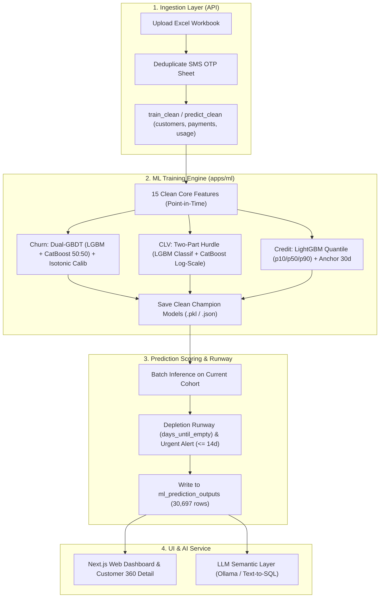

# 🏗️ Moby Analytics — End-to-End Rebuild Blueprint (Status: Completed)

> **เอกสารพิมพ์เขียวสำหรับการปรับโครงสร้างและประกอบระบบทั้งระบบ (End-to-End Rebuild)**
> บันทึกสถานะ, สถาปัตยกรรมเป้าหมาย, Contract ผลลัพธ์, และผลการทดสอบยืนยันระบบจริง

---

## 1. การปรับปรุงระบบจริง (What Was Cleaned & Pruned)

1. **ML Training & Features (`apps/ml/src/training/`):**
   - **Pruned Features:** ลดฟีเจอร์ซับซ้อนที่ overfit 60+ ตัว เหลือ **15 Core Features ภาษาคน** (ตรงกับ Colab 100%)
   - **Churn Engine:** บูรณาการ **Dual-GBDT (LightGBM + CatBoost 50:50 blend)** + Isotonic Calibrator + SHAP TreeExplainer (ได้ ROC-AUC 0.9142, PR-AUC 0.7950 บนชุดข้อมูลจริง)
   - **CLV Engine:** ใช้ **Two-Part Hurdle Model** (LightGBM Classifier + CatBoost Regressor ใน Log-Space บนกลุ่มคนที่จ่ายเงิน) พร้อม Portfolio Multiplier กำจัดปัญหา Tweedie ทำนายยอดเงินพุ่งเกินจริง
   - **Credit Engine:** ใช้ **LightGBM Quantile Regression (p10, p50, p90)** + Carryover Anchor 30d (ครอบคลุมช่วง 80% ได้จริง 88.95%) พร้อมคำนวณ Depletion Runway และเตือนลูกค้าใกล้หมดเงิน ($\le 14$ วัน)
   - **Recency Imputation Bug Fix:** ลูกค้าที่ไม่เคยจ่ายเงินหรือส่งข้อความ ถูกกำหนดเป็น `999.0` วันอย่างถูกต้อง แทนการใช้ Median (~30 วัน)
2. **Data Ingestion (`apps/api/src/lib/data-import/` & `apps/ml/src/training/data.py`):**
   - ใส่ตัวกรองตัดชีตซ้ำ `SMS_usage (OTP)` เพื่อไม่ให้ปริมาณการส่ง SMS เบิ้ล 2 เท่า
   - แก้ไขการตัดรอบข้อมูลจาก `Timedelta(days=90/180)` เป็น `DateOffset(months=3/6)` ป้องกันวันหลุดหาย
3. **Database Contract (`ml_prediction_outputs`):**
   - ตารางผลลัพธ์เก็บข้อมูลครบทุกมิติ พร้อมส่งต่อไปยัง Web Dashboard และ LLM Text-to-SQL

---

## 2. สถาปัตยกรรมระบบหลัง Rebuild (Target Architecture)

---

## 3. ตาราง 15 Core Features ภาษาคน (สอดคล้องกับ Colab 100%)

| ฟีเจอร์ | หมวดหมู่ | ความหมายทางธุรกิจ | ค่าว่าง (Null Handling) |
|---|---|---|---|
| `customer_age_days` | Profile | อายุบัญชีของลูกค้านับจากวันสมัคร (วัน) | `365` |
| `days_since_last_activity` | Activity | ไม่ได้ทำกิจกรรมใดๆ มาแล้วกี่วัน | `999.0` (ไม่เคย active) |
| `days_since_last_payment` | Payment | ไม่ได้เติมเงินมาแล้วกี่วัน | `999.0` (ไม่เคยจ่าย) |
| `days_since_last_usage` | Usage | ไม่ได้ส่ง SMS มาแล้วกี่วัน | `999.0` (ไม่เคยส่ง) |
| `payment_count_all` | Payment | จำนวนครั้งที่เคยเติมเงินทั้งหมด | `0` |
| `payment_count_180d` | Payment | จำนวนครั้งที่เติมเงินในรอบ 6 เดือน | `0` |
| `total_revenue_all` | Monetary | ยอดเงินรวมที่เคยจ่ายทั้งหมดในอดีต (บาท) | `0.0` |
| `total_revenue_180d` | Monetary | ยอดเงินที่จ่ายในรอบ 6 เดือน (บาท) | `0.0` |
| `avg_transaction_value` | Monetary | ยอดเติมเงินเฉลี่ยต่อครั้ง (บาท) | `0.0` |
| `usage_total_180d` | Usage | ยอดส่ง SMS รวมในรอบ 6 เดือน | `0.0` |
| `usage_recent_90d` | Usage | ยอดส่ง SMS ในรอบ 3 เดือน | `0.0` |
| `usage_recent_30d` | Usage | ยอดส่ง SMS ในรอบ 1 เดือนล่าสุด | `0.0` |
| `usage_active_months_180d` | Usage | จำนวนเดือนที่มีการส่งข้อความใน 6 เดือน | `0` |
| `usage_trend_pct` | Trend | อัตราการเติบโต/หดตัวของการส่งเทียบเดือนล่าสุดกับ 3 เดือน | `0.0` |
| `payment_to_usage_ratio` | Ratio | สัดส่วนเงินที่จ่ายเทียบกับปริมาณการส่ง | `0.0` |
| *Credit Extras:* | | | |
| `credit_added_180d` | Credit | เครดิตที่เติมในรอบ 6 เดือน | `0.0` |
| `credit_balance_proxy` | Balance | เครดิตคงเหลือ Point-in-time ก่อน Cutoff | `0.0` |
| `current_sms_balance` | Balance | เครดิตคงเหลือใช้งานจริง | `0.0` |
| `anchor_30d` | Anchor | ฐานยอดส่ง 30 วันก่อนหน้า | `0.0` |

---

## 4. Contract ของ `ml_prediction_outputs`

คอลัมน์ผลลัพธ์ในฐานข้อมูลที่ส่งต่อไปยัง UI และ AI Text-to-SQL:
- **ข้อมูลลูกค้า:** `acc_id`, `days_since_last_activity`, `days_since_last_payment`, `total_revenue`, `avg_transaction_value`, `n_purchases`
- **มิติ Churn:** `churn_probability` (0.00-1.00), `churn_risk_level` (`high`, `medium`, `low`), `churn_factors_json` (SHAP factors ภาษาคน)
- **มิติ CLV:** `predicted_clv_6m` (บาท), `clv_pay_probability` (0.00-1.00), `customer_value_tier` (`High`, `Mid`, `Low`), `revenue_at_risk`
- **มิติ Credit & Runway:** `predicted_credit_usage_30d`, `estimated_days_until_topup` (`days_until_empty`), `credit_urgency_level` (`critical`, `warning`, `monitor`, `stable`), `credit_forecast_interval_json` (p10, p50, p90)
- **มิติ AI & Summary:** `ai_explanation`, `ai_reasoning_json`, `priority_score`, `segment`, `priority_rank`

---

## 5. ผลการทดสอบยืนยันระบบจริง (Verification Results)

- **Unit Tests:** `bun test` ผ่าน **46/46 tests** (ครอบคลุม formatter, customer model, overview, data import, sql guard, scope)
- **Feature Builder:** `verify_feature_builder.py` สถานะ **passed** บนฐานข้อมูลจริง (29,619 บัญชี, 0 NaN, Leakage passed)
- **Preprocessing:** `verify_preprocessing.py` สถานะ **passed**
- **Promotion Gate:** `verify_promotion_policy.py` สถานะ **8/8 passed**
- **Dual-GBDT Churn Test Performance:** ROC-AUC = **0.9142**, PR-AUC = **0.7950**
- **CLV Hurdle Test Performance:** Spearman Correlation บนผู้จ่ายเงิน = **0.7470**
- **Credit Quantile Test Performance:** 80% Coverage = **88.95%**
