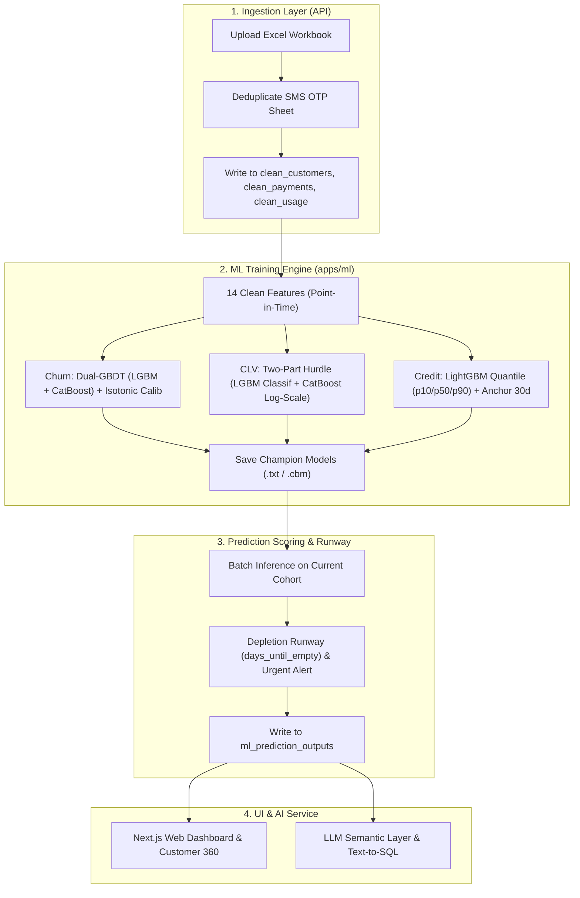

# 🏗️ Moby Analytics — End-to-End Rebuild Blueprint & Execution Plan

> **เอกสารพิมพ์เขียวสำหรับการปรับโครงสร้างและประกอบระบบทั้งระบบ (End-to-End Rebuild)**
> บันทึกสถานะ, สถาปัตยกรรมเป้าหมาย, และ Checklist การทำงานทีละจุด เพื่อให้อ่านต่อได้ทันทีแม้ Context เต็ม

---

## 1. ปัญหาในระบบปัจจุบันที่ต้องตัดทิ้ง (What to Remove & Prune)

1. **ML Training Bloat (`apps/ml/src/training/`):**
   - ฟีเจอร์รก 60+ ตัว (Shannon Entropy, Fano Factor, 2nd-order acceleration, polynomial features) $\rightarrow$ **ตัดทิ้ง เหลือ 14 Core Features ภาษาคน**
   - โมเดลสถิติ Lifetimes (BG/NBD + Gamma-Gamma) ที่พังเมื่อเจอลูกค้า Whale และ Tweedie raw-scale ที่ทายยอดเงินระเบิด $\rightarrow$ **ตัดทิ้ง แทนที่ด้วย Two-Part Hurdle (CatBoost Log-Scale)**
   - โมเดล AFT Survival และลูป CQR ซับซ้อนใน Credit $\rightarrow$ **ตัดทิ้ง แทนที่ด้วย Quantile Regression (p10, p50, p90) + Carryover Anchor**
   - โมเดล Stacking Meta-Ensemble 3 ชั้น $\rightarrow$ **แทนที่ด้วย Dual-GBDT (LightGBM + CatBoost Blend 50:50)**
2. **Data Import Flaws (`apps/api/src/lib/data-import/`):**
   - ชีต `SMS_usage (OTP)` ซ้ำกับ `SMS_usage (API)` 100% $\rightarrow$ **ใส่ตัวกรอง Deduplication ตัดทิ้งทันที**
   - การตัดข้อมูลด้วย `pd.Timedelta(days=90/180)` ทำให้รอบเดือนหลุดหาย $\rightarrow$ **เปลี่ยนเป็น `DateOffset(months=3/6)`**
3. **Database & Infrastructure Bloat:**
   - ตาราง Raw sheets 14 ตารางซ้ำซ้อน
   - Dependencies ส่วนเกิน: `arq`, `boto3`, `msgpack`, `openpyxl`, `lifetimes`

---

## 2. สถาปัตยกรรมระบบเป้าหมาย (Target End-to-End Architecture)

---

## 3. ตาราง 14 Core Features ภาษาคน (สอดคล้องกับ Colab 100%)

| ฟีเจอร์ | หมวดหมู่ | ความหมายทางธุรกิจ |
|---|---|---|
| `customer_age_days` | Profile | อายุบัญชีของลูกค้านับจากวันสมัคร (วัน) |
| `days_since_last_activity` | Activity | ไม่ได้ทำกิจกรรมใดๆ (จ่ายเงินหรือใช้) มาแล้วกี่วัน |
| `days_since_last_payment` | Payment | ไม่ได้เติมเงินมาแล้วกี่วัน (ถ้าไม่เคยเติม = 999.0) |
| `days_since_last_usage` | Usage | ไม่ได้ส่ง SMS มาแล้วกี่วัน (ถ้าไม่เคยส่ง = 999.0) |
| `payment_count_all` | Payment | จำนวนครั้งที่เคยเติมเงินทั้งหมด |
| `payment_count_180d` | Payment | จำนวนครั้งที่เติมเงินในรอบ 6 เดือน |
| `total_revenue_all` | Monetary | ยอดเงินรวมที่เคยจ่ายทั้งหมดในอดีต (บาท) |
| `total_revenue_180d` | Monetary | ยอดเงินที่จ่ายในรอบ 6 เดือน (บาท) |
| `avg_transaction_val` | Monetary | ยอดเติมเงินเฉลี่ยต่อครั้ง (บาท) |
| `usage_total_180d` | Usage | ยอดส่ง SMS รวมในรอบ 6 เดือน |
| `usage_recent_90d` | Usage | ยอดส่ง SMS ในรอบ 3 เดือน |
| `usage_recent_30d` | Usage | ยอดส่ง SMS ในรอบ 1 เดือนล่าสุด |
| `usage_active_months_180d` | Usage | จำนวนเดือนที่มีการส่งข้อความใน 6 เดือน |
| `usage_trend_pct` | Trend | อัตราการเติบโต/หดตัวของการส่งเทียบเดือนล่าสุดกับเฉลี่ย 3 เดือน |
| `payment_to_usage_ratio` | Ratio | สัดส่วนเงินที่จ่ายเทียบกับปริมาณการส่ง |

---

## 4. Contract ของ `ml_prediction_outputs`

คอลัมน์ผลลัพธ์หลักที่ถูกบันทึกลงฐานข้อมูลและส่งต่อไปยัง UI และ LLM:
- **ข้อมูลลูกค้า:** `acc_id`, `days_since_last_activity`, `days_since_last_payment`, `total_revenue`, `avg_transaction_value`, `n_purchases`
- **มิติ Churn:** `churn_probability` (0.00-1.00), `churn_risk_level` (`high`, `medium`, `low`), `churn_factors_json` (Top 3 ปัจจัยเสี่ยงจาก SHAP)
- **มิติ CLV:** `predicted_clv_6m` (บาท), `clv_pay_probability` (0.00-1.00), `customer_value_tier` (`Whale (Enterprise)`, `Core Tier`, `Standard Tier`, `Low Tier`), `revenue_at_risk`
- **มิติ Credit & Runway:** `predicted_credit_usage_30d`, `estimated_days_until_topup` (`days_until_empty`), `credit_urgency_level` (`urgent`, `warning`, `healthy`), `credit_forecast_interval_json` (p10, p50, p90)

---

## 5. แผนการลงมือทำทีละจุด (Execution Checklist)

- [ ] **Phase 1: แก้ไข Data Import Pipeline (`apps/api`)**
  - กรองชีตซ้ำ `SMS_usage (OTP)` ใน `sheet-contract.ts` / `cleanFromRaw()`
  - ปรับการคำนวณเดือนให้ใช้ Calendar Month ไม่ให้วันหลุด
- [ ] **Phase 2: ปรับปรุง Features & ML Engine (`apps/ml`)**
  - ปรับ `features.py` ให้คำนวณเฉพาะ 14 Core Features
  - ปรับ `churn_trainer.py` เป็น Dual-GBDT (LightGBM + CatBoost) + Isotonic Calibrator
  - ปรับ `clv_trainer.py` เป็น Two-Part Hurdle (Classifier + CatBoost Log-Scale) + Magnitude Calibrator
  - ปรับ `credit_trainer.py` เป็น LightGBM Quantile (p10/p50/p90) + Anchor 30d
- [ ] **Phase 3: ปรับปรุง Prediction Runner (`apps/ml/src/prediction/`)**
  - อัปเดต `scoring.py` / `runner.py` ให้ใช้ 14 ฟีเจอร์ และคำนวณ `days_until_empty` & `urgent_topup`
  - ตรวจสอบ `_replace_outputs` ให้ลงตาราง `ml_prediction_outputs` ครบทุกฟิลด์
- [ ] **Phase 4: ทดสอบ End-to-End Verification**
  - รันการทดสอบ Training Run และ Prediction Run จริงผ่าน API / CLI
  - ตรวจสอบความถูกต้องของตารางผลลัพธ์และหน้า Web UI
